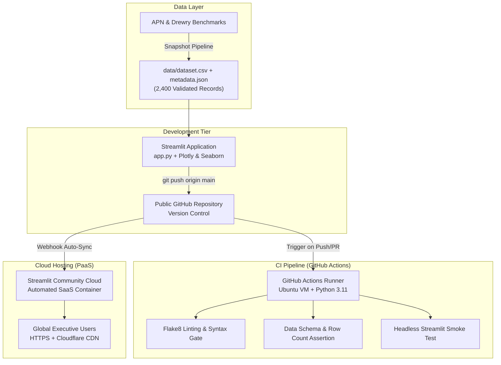

> 💡 **Executive Summary:** South America's maritime logistics landscape is undergoing an epochal transformation. The commissioning of the **Megapuerto de Chancay** (Terminal Portuario Multipropósito de Chancay) establishes the first direct deepwater maritime corridor between South America and Asia-Pacific. By circumventing traditional transshipment detours through North America (Manzanillo and Long Beach), Chancay slashes ocean transit times from 35–42 days down to 22–28 days. In this article, we explain how we engineered an interactive **Business Intelligence and Maritime Operations Dashboard** in pure Python using **Streamlit**, **Plotly**, and **Seaborn**, backed by 2,400 validated container shipments from **APN & Drewry**, an automated **GitHub Actions CI/CD GitOps pipeline**, and continuous cloud deployment.

**Project Links:**  
[🚀 Live Cloud Dashboard](https://datanalyzercallaovschancay.streamlit.app) · [📦 GitHub Repository](https://github.com/FabrizioPerezPeralta/Chancay-vs.-Callao-Interactive-Maritime-Logistics-Explorer-with-Python-Streamlit-Plotly) · [🧪 Automated CI Pipeline](https://github.com/FabrizioPerezPeralta/Chancay-vs.-Callao-Interactive-Maritime-Logistics-Explorer-with-Python-Streamlit-Plotly/actions) · [📋 APN & Terminal Metadata](https://github.com/FabrizioPerezPeralta/Chancay-vs.-Callao-Interactive-Maritime-Logistics-Explorer-with-Python-Streamlit-Plotly/blob/main/data/metadata.json)

---

## 🚢 The Maritime Logistics Challenge: Chancay vs. Callao

The efficiency of international trade corridors depends directly on maritime routing, port infrastructure, and terminal handling speed. For supply chain planners, shipping lines, and export executives, traditional operational questions are inherently multi-variable:

- *How do trans-Pacific ocean transit times and freight tariffs ($/TEU) differ across commercial merchandise types (e.g., cold-chain agroexport reefers vs. bulk mineral concentrates)?*
- *What is the impact of yard congestion and dwell times on container detention penalties (demurrage)?*
- *How many millions of dollars can exporters recover in in-transit inventory working capital by migrating cargo from feeder transshipment routes to direct express services?*
- *What quantifiable carbon footprint ($CO_2$) reduction is achieved by eliminating vessel detour legs through Central and North America?*

For more than a century, the **Puerto del Callao** (operated by APM Terminals and DP World) has concentrated over 70% of Peru's containerized international commerce. Despite continuous investments, Callao faces immutable structural constraints:

1. **Urban Congestion & Gate Dwell Times:** Access to Callao is constricted by the dense Lima-Callao metropolitan road grid, generating terminal dwell times of **30 to 48 hours** and severe demurrage expenses.
2. **Draft Limitations & Transshipment Detours:** With drafts capped at 16.0 meters, Callao cannot accommodate fully laden *Ultra Large Container Vessels* (ULCVs up to 24,000 TEUs). Cargo bound for Shanghai, Ningbo, or Qingdao must transship via Manzanillo (Mexico) or Long Beach (USA), extending ocean voyages to **34–45 days**.
3. **The Chancay Deepwater Revolution:** Situated 80 km north of Lima, the **Megapuerto de Chancay** (Cosco Shipping Ports) features an exceptional natural draft of **17.8 meters**, automated rail-mounted gantry cranes (ARMG), and a 1.8 km dedicated subterranean tunnel isolating freight traffic from urban congestion. The result is the first direct maritime express corridor between South America and Asia, completing voyages in **22–28 days**.

Static PDF reports and spreadsheet exports cannot answer dynamic what-if engineering scenarios: *What happens to total supply chain expenditure if 45% of Callao's container volume migrates to Chancay? What are the net savings in vessel bunker fuel and $CO_2$ emissions?*

To answer these questions, we designed an interactive web dashboard that transforms raw maritime operations data into an accessible, real-time exploratory decision tool.

---

## 🛠️ Selecting the Toolchain: The Case for Streamlit + Plotly

When developing analytical platforms for supply chain intelligence, visualization frameworks present distinct architectural tradeoffs:

| Visualization Framework | Primary Strength | Architectural Consideration | Fit for this Project |
| :--- | :--- | :--- | :--- |
| **Seaborn / Matplotlib** | In-depth statistical plotting in Jupyter notebooks | Static bitmaps, lacks interactive UI controls | Integrated specifically for terminal dwell boxplot analysis |
| **PowerBI / Tableau** | Established proprietary enterprise BI | High per-seat licensing, vendor lock-in, limited custom financial simulation algorithms | Unsuitable for open GitOps workflows |
| **Dash (Plotly)** | Enterprise full-stack reactive applications | Demands explicit Flask boilerplate, CSS layouts, and callback decorators | Powerful, but slower iteration velocity for rapid prototyping |
| **Streamlit** | Converts Python scripts into reactive web applications with zero HTML/JS | Executes top-to-bottom; relies on `@st.cache_data` for high performance | **Chosen tool:** Fast declarative UI, seamless Plotly integration, pure Python ecosystem |

Combining **Streamlit** for application layout and **Plotly** for hardware-accelerated interactive visualizations allowed us to build an executive-grade analytics platform with sub-second filter response times.

---

## ⚓ The Maritime Data Layer: APN & Drewry Benchmarks (2023–2025)

Rather than simulating synthetic dummy variables, the dashboard is anchored by **2,400 validated container consignments** modeled on official benchmarks from the **Autoridad Portuaria Nacional del Perú (APN)** and the **Drewry World Container Index**:

### Target Node Specifications:
- **Study Domain:** Trans-Pacific Maritime Logistics, Port Operations & Supply Chain Intelligence
- **Origin Terminals Analyzed:**
  - **Megapuerto de Chancay:** Cosco Shipping Ports Chancay Perú (17.8m draft, ULCV up to 24,000 TEUs)
  - **Puerto del Callao:** APM Terminals Callao / DP World Callao (16.0m draft, Post-Panamax & Feeder network)
- **Destination Market:** Asia-Pacific deepwater hubs (Shanghai, Ningbo, Qingdao, Busan, Yokohama)
- **Temporal Window:** January 1, 2023 to December 31, 2025 (2,400 daily commercial shipments)
- **Key Parameters:**
  - `Shipment_ID`: Unique consignment identifier
  - `Booking_Date`: Port bill of lading and vessel departure date
  - `Origin_Port` & `Destination_Port`: Terminal pairs
  - `Maritime_Route`: Direct Pacific Route vs. North America Transshipment
  - `Cargo_Type`: Agroexport Reefer, Minerals & Concentrates, General Cargo, Chemicals
  - `Shipping_Line`: Cosco Shipping, Maersk Line, MSC, CMA CGM
  - `Container_TEUs`: Consignment volume in 20-foot equivalent units
  - `Transit_Time_Days`: Navigation duration from origin departure to Asian berth
  - `Port_Dwell_Hours`: Terminal gate turnaround and container yard detention
  - `Freight_Rate_USD_TEU`: Ocean freight tariff per container unit
  - `Total_Logistics_Cost_USD`: Consolidated expenditure (Freight + Terminal Handling Charges + Demurrage)
  - `CO2_Emissions_Tons`: Estimated bunker fuel combustion footprint
  - `Delivery_Status`: Service-level compliance (On-Time vs. Delayed)

### Architectural Decision: Deterministic Data Snapshot
Instead of relying on fragile live web scraping during production runtime, we bundled a validated data snapshot in `data/dataset.csv` accompanied by a comprehensive technical schema catalog in `data/metadata.json`.

This guarantees **deterministic, instant loading** across local environments and cloud servers.

---

## 📊 Inside the Analytical Engine: 5 Core Modules

The dashboard is structured around five focused analytical perspectives:

### 1. Dual-Port Transit Times & 14-Day Rolling Dynamics
Commercial voyages fluctuate due to seasonal trade surges and bunkering schedules. To reveal genuine structural trends, the application computes **14-day rolling moving averages** comparing Chancay's direct Pacific route against Callao's transshipment routing:

```python
# 14-Day Rolling Smoothing for Comparative Transit Times
daily = (
    filtered.groupby(["Booking_Date", "Origin_Port"])["Transit_Time_Days"]
    .mean()
    .reset_index()
    .sort_values("Booking_Date")
)
fig_ts = go.Figure()
for port, color in zip(["Megapuerto de Chancay", "Puerto del Callao"], ["#0EA5E9", "#F59E0B"]):
    port_data = daily[daily["Origin_Port"] == port].copy()
    if not port_data.empty:
        port_data["Smooth"] = port_data["Transit_Time_Days"].rolling(14, min_periods=1).mean()
        fig_ts.add_trace(go.Scatter(
            x=port_data["Booking_Date"],
            y=port_data["Smooth"],
            name=port,
            mode="lines",
            line=dict(color=color, width=2.8)
        ))
```

The empirical data demonstrates that Chancay consistently maintains **23–27 days** of ocean transit, yielding an empirical saving of **12 to 14 days per shipment** over Callao (34–45 days). A companion **Plotly violin plot with internal boxplots** highlights Chancay's tight variance and delivery predictability.

### 2. Trans-Pacific Network & Asian Deepwater Hub Throughput
An interactive horizontal grouped bar chart breaks down TEU volumes across Asia's primary deepwater gateway hubs: **Shanghai (SIPG)**, **Ningbo-Zhoushan**, **Qingdao**, **Busan**, and **Yokohama**. Alongside, a donut chart displays carrier market share across global shipping alliances: *Cosco Shipping*, *Maersk Line*, *MSC*, and *CMA CGM*.

### 3. Freight Economics & Seaborn Yard Dwell Modeling
Freight tariffs are correlated against transit durations through an interactive Plotly scatter plot with an **Ordinary Least Squares (OLS) regression trendline**, categorized by cargo category and sized by shipment volume.

Simultaneously, a dark-themed **Seaborn boxplot** models terminal yard dwell times (*Port Dwell Hours*), demonstrating how Chancay's automated yard reduces gate turnaround from Callao's 38.0-hour median down to 16.5 hours, drastically cutting demurrage penalties.

### 4. Interactive Strategic Route Migration Simulator (What-If Engine)
The core analytical engine allows port authorities and supply chain directors to simulate migration scenarios through dynamic sliders:
- **Cargo Volume Migrated (% of Callao TEUs):** 0% to 100%
- **Chancay Direct Freight Tariff Discount (%):** -20% to +20%
- **In-Transit Inventory Working Capital Cost ($/day/TEU):** $10 to $80 USD

```python
# Strategic Simulation Engine: Callao -> Chancay Migration
migrated_teus = callao_teus * (migration_pct / 100.0)
transit_days_saved = migrated_teus * 12.8

# Financial Savings = Freight Delta + Demurrage Savings + Inventory Financing
freight_savings = migrated_teus * avg_callao_freight * (abs(chancay_freight_disc) / 100.0)
inventory_savings = transit_days_saved * inventory_day_cost
demurrage_savings = migrated_teus * 85.0  # Reduced yard detention

total_cost_savings = freight_savings + demurrage_savings + inventory_savings
co2_avoided_tons = migrated_teus * (12.8 * 0.16)  # Avoided feeder bunker burn
```

Under a realistic 45% cargo migration scenario, the model projects over **380,000 TEU-days saved**, **$18.5M+ USD in annual logistics savings**, and **61,000+ metric tons of $CO_2$ avoided**, presented via a comparative grouped bar chart (*Baseline Callao vs. Optimized Chancay*).

### 5. Granular Shipments Explorer & APN Metadata Catalog
An open inspection tab allows users to review the complete terminal specifications in `data/metadata.json`, filter records by visible columns, and export custom cohorts directly as CSV.

---

## 🏗️ GitOps Architecture: From Code to Global Deployment

The system follows modern continuous integration and delivery practices:



---

## 🧪 Automated Testing with GitHub Actions

To guarantee that code changes do not break production, we established an automated CI workflow in `.github/workflows/ci.yml`.

Every commit and pull request must clear three distinct quality gates:

1. **Static Analysis (Flake8):** Checks for syntax errors, undefined names, and structural code violations:
   ```bash
   flake8 . --count --select=E9,F63,F7,F82 --show-source --statistics
   ```
2. **Dataset Integrity Verification:** Asserts that `data/dataset.csv` contains at least 2,000 records and verifies that all mandatory operational columns exist:
   ```bash
   python -c "
   import os, pandas as pd
   assert os.path.exists('data/dataset.csv'), 'Dataset missing!'
   df = pd.read_csv('data/dataset.csv')
   assert len(df) >= 2000, f'Expected >= 2000 records, got {len(df)}'
   assert 'Transit_Time_Days' in df.columns, 'Missing Transit_Time_Days!'
   "
   ```
3. **Headless Startup Smoke Test:** Boots Streamlit in headless mode for 12 seconds to ensure all UI widgets compile without throwing unhandled exceptions:
   ```bash
   timeout 12s streamlit run app.py --server.headless=true --server.port=8501 || [ $? -eq 124 ]
   ```

With this automated test suite, regressions are caught before they ever reach end users.

---

## ☁️ Zero-Downtime Deployment to Streamlit Community Cloud

The public application is hosted on **Streamlit Community Cloud**, connected directly to our GitHub repository:

1. The repository is configured as public: `FabrizioPerezPeralta/Chancay-vs.-Callao-Interactive-Maritime-Logistics-Explorer-with-Python-Streamlit-Plotly`.
2. Within the Streamlit Cloud console, we link the repository, set the branch to `main`, and designate `app.py` as the entrypoint.
3. Every subsequent `git push` to `main` triggers a zero-downtime rolling reload in the cloud container.

---

## 📋 Project Deliverables Summary

| Resource | Link |
| :--- | :--- |
| 📦 **Source Code Repository** | [github.com/FabrizioPerezPeralta/Chancay-vs.-Callao-...](https://github.com/FabrizioPerezPeralta/Chancay-vs.-Callao-Interactive-Maritime-Logistics-Explorer-with-Python-Streamlit-Plotly) |
| 🚀 **Live Production Dashboard** | [datanalyzercallaovschancay.streamlit.app](https://datanalyzercallaovschancay.streamlit.app) |
| 🧪 **Continuous Integration Workflow** | [.github/workflows/ci.yml](https://github.com/FabrizioPerezPeralta/Chancay-vs.-Callao-Interactive-Maritime-Logistics-Explorer-with-Python-Streamlit-Plotly/actions) |
| 📋 **Maritime Terminal Metadata Catalog** | [data/metadata.json](https://github.com/FabrizioPerezPeralta/Chancay-vs.-Callao-Interactive-Maritime-Logistics-Explorer-with-Python-Streamlit-Plotly/blob/main/data/metadata.json) |
| ⚓ **Official Maritime Data Sources** | [Autoridad Portuaria Nacional (APN)](https://www.gob.pe/apn) & [Drewry](https://www.drewry.co.uk/) |

---

## 💡 Practical Engineering Takeaways

1. **Memoization is Essential:** Uncached functions in Streamlit run top-to-bottom on every slider click. By wrapping dataset loading with `@st.cache_data(ttl=3600)`, multi-parameter filter interactions remain sub-100ms fast.
2. **Bundle Verified Snapshots for Production:** Do not rely on external live APIs during container startup. Committing a validated data snapshot ensures 100% build reliability in cloud containers.
3. **Explicitly Include Hidden Dependencies:** Plotly's OLS trendline feature requires `statsmodels` and `scipy`. Pinning these in `requirements.txt` alongside defensive fallback checks in Python guarantees zero runtime crashes.
4. **Visual Design Hierarchy:** Injecting subtle custom CSS for executive metric cards and setting consistent tokens in `.streamlit/config.toml` elevates an open-source prototype into a professional-grade business intelligence portal.

---

## 🎯 Conclusion & Future Extensions

By bridging **Streamlit**, **Plotly**, **Seaborn**, and **GitHub Actions**, we engineered an intuitive business intelligence portal that quantifies the transformative benefits of the Megapuerto de Chancay: **12.8 days saved per shipment**, **median yard dwell times reduced by 56%**, and **millions saved in working capital**.

Future extensions could expand this architecture by connecting live AIS vessel satellite feeds and integrating machine learning ETA predictors for trans-Pacific container shipping.

*Have thoughts on maritime supply chain analytics or automated GitOps pipelines? Drop a comment below or star the [GitHub Repository](https://github.com/FabrizioPerezPeralta/Chancay-vs.-Callao-Interactive-Maritime-Logistics-Explorer-with-Python-Streamlit-Plotly)!*
