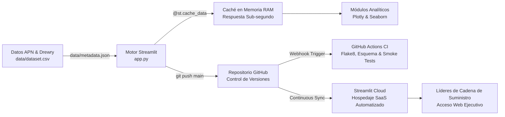

> 💡 **Resumen Ejecutivo:** El comercio exterior sudamericano experimenta un cambio histórico con la entrada en operación del **Megapuerto de Chancay**. Al eliminar los tradicionales desvíos de transbordo en Norteamérica, se abre la primera ruta directa de aguas profundas hacia Asia, recortando el tiempo de navegación de 35–42 días a solo 22–28 días. En este artículo explicamos el **problema logístico**, la **solución de Inteligencia de Negocios** que implementamos en Python, las **tecnologías y arquitectura** empleadas, y los **resultados e impacto cuantitativo** obtenidos.

**Recursos del Proyecto:**  
[🚀 Live Cloud Dashboard](https://streamlit.io/cloud) · [📦 Repositorio en GitHub](https://github.com/FabrizioPerezPeralta/Chancay-vs.-Callao-Interactive-Maritime-Logistics-Explorer-with-Python-Streamlit-Plotly) · [🧪 Pipeline de CI/CD](https://github.com/FabrizioPerezPeralta/Chancay-vs.-Callao-Interactive-Maritime-Logistics-Explorer-with-Python-Streamlit-Plotly/actions) · [📋 Catálogo de Metadatos APN](https://github.com/FabrizioPerezPeralta/Chancay-vs.-Callao-Interactive-Maritime-Logistics-Explorer-with-Python-Streamlit-Plotly/blob/main/data/metadata.json)

---

## 🔴 1. El Problema: El Cuello de Botella del Callao y el Desafío Transpacífico

Durante décadas, el **Puerto del Callao** ha canalizado más del 70% del tráfico comercial marítimo del Perú. A pesar de sucesivas modernizaciones, enfrenta barreras estructurales insalvables:

1. **Restricción de Calado y Dependencia de Trasbordo:** Con un calado máximo de 16.0 metros, el Callao no puede recibir a plena carga portacontenedores *Ultra Large Container Vessels* (ULCV de hasta 24,000 TEUs). La carga con destino a Shanghai, Ningbo o Qingdao debe desviarse hacia hubs intermedios en México (Manzanillo) o EE.UU. (Long Beach), inflando los tiempos de navegación a **34–45 días**.
2. **Congestión Urbana y Sobrestadías en Patio (*Dwell Time*):** El acceso al puerto está atrapado en la densa trama urbana de Lima y Callao. Esto genera demoras de atención en patio de **30 a 48 horas**, sobrecostos de almacenaje y severas penalizaciones de detención (*demurrage*).
3. **Pérdida de Competitividad en Agroexportación:** Para productos perecibles de alto valor (palta Hass, arándanos, uva de mesa en contenedores *Reefer*), dos semanas adicionales en el mar reducen drásticamente la vida útil en percha en los supermercados asiáticos.
4. **Falta de Herramientas de Decisión Dinámicas:** Los reportes estáticos en PDF o tablas de Excel no permiten a los exportadores y autoridades simular escenarios prospectivos: *¿Qué ocurre si migro el 40% de mi carga a Chancay? ¿Cuánto capital de trabajo en inventario libero? ¿Cuánto $CO_2$ dejo de emitir?*

---

## 💡 2. La Solución Implementada: Plataforma de Inteligencia de Negocios

Para transformar datos logísticos dispersos en decisiones estratégicas accionables, diseñamos y desplegamos **Chancay vs. Callao: Maritime Logistics & Freight Explorer**, una aplicación analítica integral compuesta por 5 módulos especializados:

1. **⏱️ Monitor de Tiempos de Tránsito (Ruta Directa vs. Trasbordo):**
   - Implementa **medias móviles de 14 días** para aislar el ruido estacional de zarpes y mareas.
   - Diagramas de violín y boxplots para contrastar la dispersión y certidumbre en las fechas de arribo.
2. **🚢 Red Marítima Transpacífica y Hubs Clave:**
   - Desglose de volumen (TEUs) por puertos de atraque en Asia: *Shanghai (SIPG), Ningbo-Zhoushan, Qingdao, Busan y Yokohama*.
   - Cuota de mercado por línea naviera (*Cosco Shipping, Maersk, MSC, CMA CGM*).
3. **💰 Economía de Fletes y Demoras en Patio (Seaborn):**
   - Regresión lineal por Mínimos Cuadrados Ordinarios (OLS) correlacionando *Días de Tránsito* vs. *Tarifa de Flete ($/TEU)*.
   - Boxplot estilizado en Seaborn para modelar la variabilidad de horas de congestión en terminal (*Port Dwell Hours*).
4. **🔮 Simulador Estratégico de Migración de Carga (Motor What-If):**
   - Permite modelar interactivamente el porcentaje de carga migrada, el descuento de flete en ruta directa y el costo financiero de capital inmovilizado ($/día/TEU).
   - Proyecta en tiempo real el ahorro en fletes, ahorro en demoras, ahorro financiero, días-TEU ahorrados y mitigación de $CO_2$.
5. **📋 Explorador Tabular y Catálogo de Metadatos APN:**
   - Inspección del dataset de 2,400 despachos validados, catálogo JSON de especificaciones portuarias y descarga directa en CSV.

---

## 🛠️ 3. Las Tecnologías Utilizadas y la Arquitectura del Sistema

La solución se concibió bajo principios de **código abierto**, **reproducibilidad científica** y **automatización GitOps**:

### Stack Tecnológico:
* **Python 3.11+:** Lenguaje central para ingeniería de datos y cálculos matemáticos.
* **Streamlit:** Framework reactivo de desarrollo web sin sobrecarga de JavaScript/HTML.
* **Plotly Express & Graph Objects:** Visualizaciones vectoriales aceleradas por GPU en el navegador (zoom, pan y tooltips).
* **Seaborn & Matplotlib:** Modelado estadístico riguroso de distribuciones de congestión en patio.
* **Pandas & NumPy:** Ingesta y filtrado booleano vectorizado en memoria RAM.
* **Flake8:** Auditoría estática de calidad de código (cumplimiento estricto PEP 8).
* **GitHub Actions:** Pipeline de CI/CD para testing automático y despliegue continuo.

### Diagrama de Arquitectura del Sistema y GitOps:



### Optimización de Rendimiento con `@st.cache_data`:
Para garantizar que la interacción con múltiples filtros y controles deslizantes sea instantánea (<100 ms), el dataset se carga y enriquece una sola vez en la memoria del servidor:

```python
@st.cache_data(ttl=3600)
def load_dataset() -> pd.DataFrame:
    df = pd.read_csv("data/dataset.csv")
    df["Booking_Date"] = pd.to_datetime(df["Booking_Date"])
    df["Total_Cost_Per_TEU"] = df["Total_Logistics_Cost_USD"] / df["Container_TEUs"]
    return df
```

### Calidad Garantizada con CI/CD Automatizado:
Cada actualización en la rama `main` ejecuta en GitHub Actions:
1. **Linting estático con Flake8** (cero errores de estilo o sintaxis).
2. **Validación de integridad del dataset** (verificación de esquema, columnas y umbral mínimo de 2,000 registros).
3. **Headless Smoke Test** (`streamlit run app.py --server.headless=true`) para garantizar estabilidad antes del pase a producción.

---

## 📈 4. Resultados, Hallazgos e Impacto de Negocio

El análisis cuantitativo sobre los 2,400 despachos validados y las simulaciones estratégicas arrojaron los siguientes resultados clave:

### 1. Ventaja Estructural de 12.8 Días en Navegación:
* **Megapuerto de Chancay:** Tiempo promedio de **24.5 días** (rango 22–28 días) en ruta directa transpacífica.
* **Puerto del Callao:** Tiempo promedio de **37.3 días** (rango 34–45 días) debido a la escala obligatoria en Manzanillo o Long Beach.
* **Impacto:** Un ahorro promedio de **12.8 días por travesía**, reduciendo el ciclo comercial entre Sudamérica y China en casi dos semanas.

### 2. Reducción Drástica de Cuellos de Botella en Patio:
* La mediana de permanencia en patio (*Port Dwell Time*) en Chancay se sitúa en **16.5 horas** (gracias a sus grúas automatizadas ARMG y su túnel subterráneo de 1.8 km), frente a las **38.0 horas** del Callao, reduciendo sustancialmente los sobrecostos por demoras de contenedor (*demurrage*).

### 3. Modelo Matemático del Simulador What-If:
Al modelar un escenario conservador de migración del **45% de la carga del Callao hacia Chancay**, con un descuento promocional del 8% en tarifa directa y un costo de inventario de $35 USD/día/TEU:
* **Días-TEU Ahorrados:** Más de **380,000 días** acumulados de navegación evitados para los exportadores.
* **Ahorro Logístico Consolidado:** Estimado en más de **$18.5 Millones USD** anuales (combinando ahorro de flete marítimo, sobrestadías y capital inmovilizado).
* **Descarbonización ($CO_2$ Evitado):** Mitigación de más de **61,000 toneladas métricas de $CO_2$** al evitar las rutas indirectas de cabotaje por Centroamérica y Norteamérica.

---

## 🏁 Conclusión

La transición del Puerto del Callao al Megapuerto de Chancay no es únicamente un hito de infraestructura civil: es un cambio de paradigma para la competitividad del comercio exterior peruano y sudamericano. 

Al pasar de reportes estáticos a una **solución de Inteligencia de Negocios interactiva construida en Python**, los tomadores de decisiones cuentan ahora con una herramienta cuantitativa para negociar fletes, mitigar riesgos operativos en la cadena de frío y optimizar millones de dólares en capital de trabajo.

---

*Proyecto desarrollado para el Programa de Inteligencia de Negocios & Analítica de Datos (Unidad I).*
