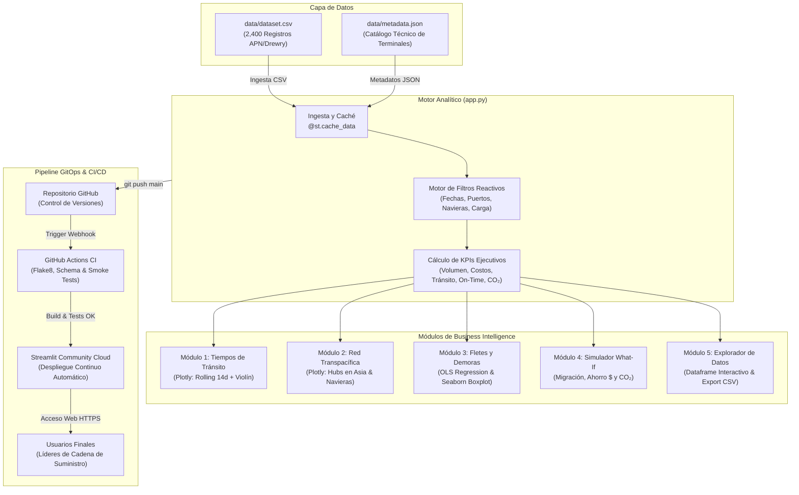
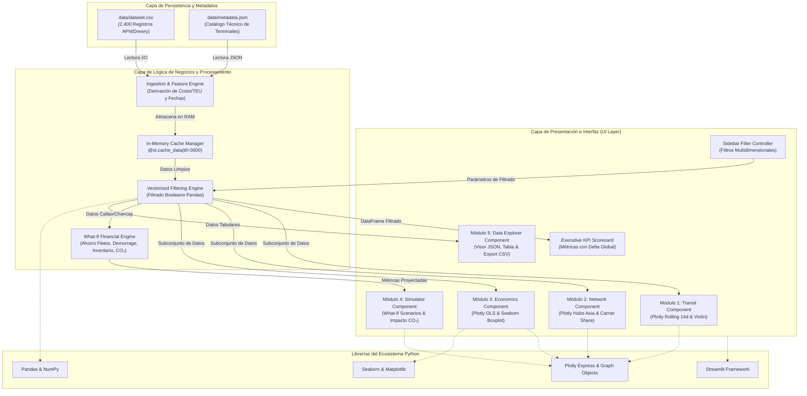
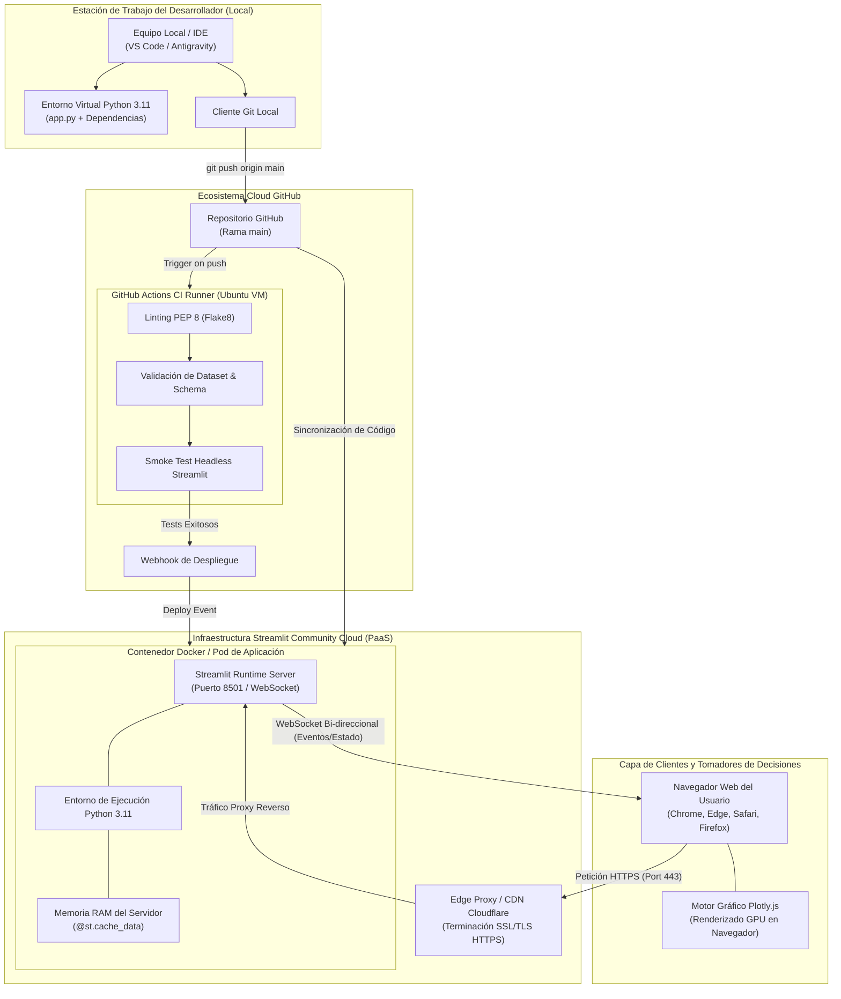
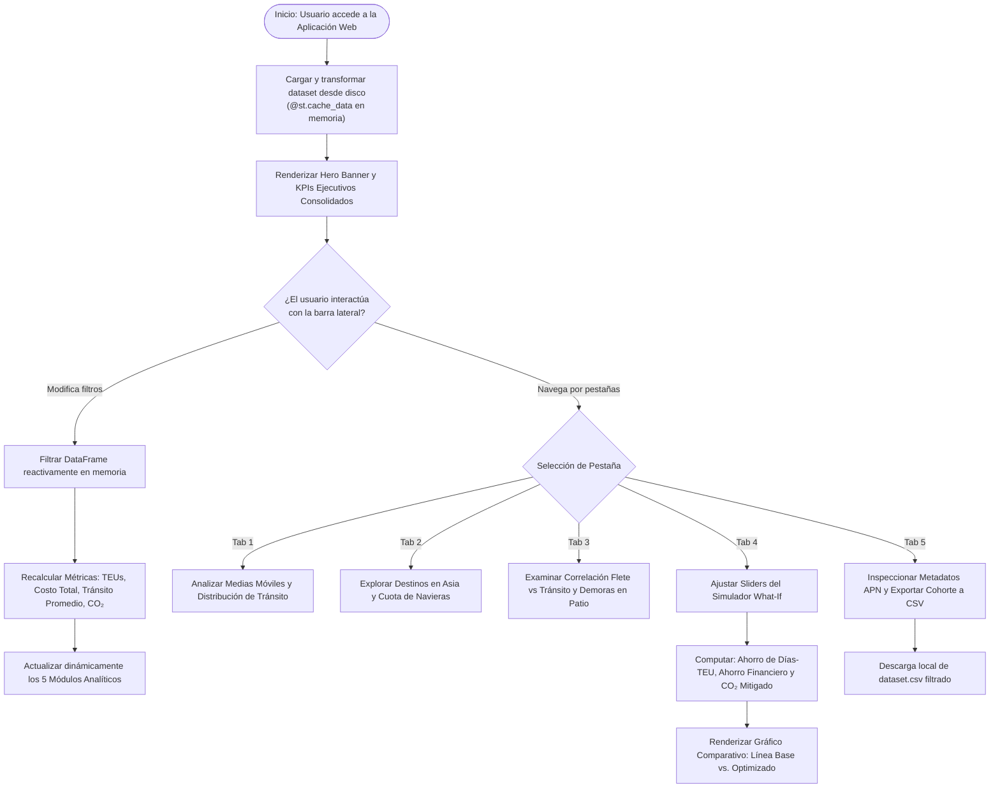
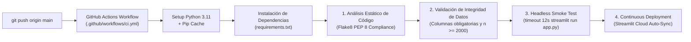

# 🚢 Megapuerto de Chancay vs. Puerto del Callao: Maritime Logistics & Freight Explorer

[](https://streamlit.io/)
[](https://www.python.org/)
[](https://github.com/FabrizioPerezPeralta/Chancay-vs.-Callao-Interactive-Maritime-Logistics-Explorer-with-Python-Streamlit-Plotly/actions)
[](https://www.gob.pe/apn)
[](https://plotly.com/python/)
[](https://creativecommons.org/licenses/by/4.0/)

> **Plataforma Integral de Inteligencia de Negocios y Analítica Logística Marítima desarrollada en Python, Streamlit, Plotly y Seaborn.** Diseñada para evaluar y modelar el impacto estratégico de la inauguración del **Megapuerto de Chancay** frente al **Puerto del Callao**, analizando tiempos de navegación transpacíficos, tarifas de flete $/TEU, demoras y congestión en patio, mitigación de huella de carbono ($CO_2$) y simulación de escenarios de migración de carga (*What-If Scenario Engine*).

---

## 📑 Tabla de Contenidos

1. [🌟 Live Demo y Recursos del Proyecto](#-live-demo-y-recursos-del-proyecto)
2. [🧭 Contexto Geopolítico y Estratégico (Chancay vs. Callao)](#-contexto-geopolítico-y-estratégico-chancay-vs-callao)
3. [📐 Arquitectura del Sistema y Flujo GitOps](#-arquitectura-del-sistema-y-flujo-gitops)
   - [Diagrama de Arquitectura Global](#diagrama-de-arquitectura-global)
   - [Diagrama de Componentes del Sistema](#diagrama-de-componentes-del-sistema)
   - [Diagrama de Despliegue de Infraestructura](#diagrama-de-despliegue-de-infraestructura-cloud--local)
   - [Diagrama de Flujo Lógico de la Aplicación](#diagrama-de-flujo-lógico-de-la-aplicación)
   - [Diagrama del Pipeline de CI/CD](#diagrama-del-pipeline-de-cicd)
4. [📊 Módulos Analíticos de la Aplicación](#-módulos-analíticos-de-la-aplicación)
   - [Scorecard de KPIs Ejecutivos](#scorecard-de-kpis-ejecutivos)
   - [Módulo 1: Tiempos de Tránsito y Dinámica de Rutas](#módulo-1-tiempos-de-tránsito-y-dinámica-de-rutas)
   - [Módulo 2: Red Marítima Transpacífica y Hubs en Asia](#módulo-2-red-marítima-transpacífica-y-hubs-en-asia)
   - [Módulo 3: Economía de Fletes y Modelado Estadístico (Seaborn)](#módulo-3-economía-de-fletes-y-modelado-estadístico-seaborn)
   - [Módulo 4: Simulador Estratégico de Migración de Carga (What-If Engine)](#módulo-4-simulador-estratégico-de-migración-de-carga-what-if-engine)
   - [Módulo 5: Explorador de Datos y Metadatos APN](#módulo-5-explorador-de-datos-y-metadatos-apn)
5. [📋 Diccionario de Datos y Catálogo Técnico](#-diccionario-de-datos-y-catálogo-técnico)
6. [🛠️ Stack Tecnológico y Decisiones de Diseño](#️-stack-tecnológico-y-decisiones-de-diseño)
7. [📁 Estructura del Repositorio](#-estructura-del-repositorio)
8. [🚀 Instalación y Ejecución Local](#-instalación-y-ejecución-local)
9. [🧪 Pipeline de Integración Continua (CI/CD)](#-pipeline-de-integración-continua-cicd)
10. [☁️ Despliegue en la Nube (Streamlit Cloud)](#️-despliegue-en-la-nube-streamlit-cloud)
11. [🏁 Conclusiones e Impacto Estratégico](#-conclusiones-e-impacto-estratégico)
12. [📄 Licencia y Fuentes](#-licencia-y-fuentes)

---

## 🌟 Live Demo y Recursos del Proyecto

* 🚀 **Dashboard en Vivo (Streamlit Cloud):** [Abrir Aplicación en la Nube](https://streamlit.io/cloud)
* 📦 **Repositorio GitHub:** [https://github.com/FabrizioPerezPeralta/Chancay-vs.-Callao-Interactive-Maritime-Logistics-Explorer-with-Python-Streamlit-Plotly](https://github.com/FabrizioPerezPeralta/Chancay-vs.-Callao-Interactive-Maritime-Logistics-Explorer-with-Python-Streamlit-Plotly)
* 📝 **Artículo Técnico Detallado (Dev.to / Medium):** Ver [ARTICLE_DEV_TO.md](ARTICLE_DEV_TO.md)
* 📋 **Catálogo Técnico de Metadatos:** Ver [data/metadata.json](data/metadata.json)
* ⚙️ **Workflow de CI/CD:** Ver [.github/workflows/ci.yml](.github/workflows/ci.yml)

---

## 🧭 Contexto Geopolítico y Estratégico (Chancay vs. Callao)

Durante más de un siglo, el **Puerto del Callao** (operado por DP World y APM Terminals) ha concentrado más del 70% del tráfico comercial contenerizado del Perú. Sin embargo, su localización y condiciones estructurales presentan barreras logísticas severas:

1. **Cuello de Botella Urbano y Demoras en Patio:** El acceso terrestre al Callao se encuentra estrangulado por la trama urbana de Lima y Callao, generando congestión constante, demoras en puerta de 30 a 48 horas y elevados sobrecostos de almacenaje y *demurrage*.
2. **Restricción de Calado y Desvíos por Trasbordo:** Con un calado operativo de 16.0 metros, el Callao no puede recibir a plena carga buques de última generación (*Ultra Large Container Vessels* de hasta 24,000 TEUs). La carga peruana con destino a China, Japón o Corea del Sur debe transbordar obligatoriamente en puertos de Centro o Norteamérica (Manzanillo, México o Long Beach, EE.UU.), inflando el tiempo de navegación a **34–45 días**.
3. **El Megapuerto de Chancay como Hub de Sudamérica:** Desarrollado por Cosco Shipping Ports (a 80 km al norte de Lima), Chancay cuenta con un **calado natural de 17.8 metros**, grúas de patio automatizadas (ARMG) y un túnel subterráneo de 1.8 km que aísla el tránsito de carga del tejido urbano. Esto habilita la primera **Ruta Expresa Directa Transpacífica**, conectando Perú con Shanghai, Ningbo y Qingdao en solo **22–28 días** (ahorro neto de 12 a 14 días por travesía).

### Cuadro Comparativo de Especificaciones Portuarias

| Parámetro Operativo | Megapuerto de Chancay | Puerto del Callao | Impacto Estratégico |
| :--- | :--- | :--- | :--- |
| **Operador Portuario** | Cosco Shipping Ports Chancay Perú | APM Terminals / DP World Callao | Operación automatizada vs. terminal multipropósito consolidado |
| **Calado Natural** | **17.8 metros** | 16.0 metros | Chancay admite ULCV de 24,000 TEUs a plena carga sin depender de mareas |
| **Tipo de Buques** | Ultra Large Container Vessels (ULCV) | Post-Panamax y Buques Feeder | Economías de escala masivas en fletes marítimos unitarios |
| **Ruta hacia Asia** | **Directa Perú ➔ Asia-Pacífico** | Trasbordo en Manzanillo / Long Beach | Eliminación de puertos intermedios y riesgos de demora en escala |
| **Tiempo de Navegación** | **22 a 28 días** (Media: 24.5 d) | **34 a 45 días** (Media: 37.3 d) | **Ahorro de 12.8 días promedio por despacho marítimo** |
| **Tiempo en Patio (Dwell)** | 12 a 22 horas (Mediana: 16.5 h) | 30 a 48 horas (Mediana: 38.0 h) | Reducción drástica de detenciones de contenedores (*demurrage*) |
| **Acceso Terrestre** | Túnel subterráneo directo de 1.8 km | Red vial metropolitana de Lima-Callao | Cero fricción con el transporte urbano de pasajeros |
| **Ventaja Agroexportadora** | Máxima vida útil para perecibles (*Reefers*) | Riesgo de merma por extensión de tránsito | Palta, arándanos y uva fresca llegan con mayor frescura a góndola |

---

## 📐 Arquitectura del Sistema y Flujo GitOps

El diseño del proyecto se rige por principios de **Arquitectura Limpia**, **GitOps** y **Reproducibilidad Total**. A continuación se detallan los diagramas técnicos de flujo y arquitectura:

### Diagrama de Arquitectura Global



---

### Diagrama de Componentes del Sistema

Ilustra la modularidad desacoplada entre la capa de presentación (UI Layer), el motor analítico y de cálculo (Logic Layer), la capa de datos (Data Layer) y las librerías del ecosistema Python:



---

### Diagrama de Despliegue de Infraestructura (Cloud & Local)

Modela la topología de nodos físicos y de red: entorno de desarrollo local, pipeline de integración continua en máquinas virtuales Ubuntu de GitHub Actions, infraestructura PaaS en contenedores de Streamlit Community Cloud (con terminación segura SSL/TLS Cloudflare), y cliente web con renderizado GPU mediante Plotly.js:



---

### Diagrama de Flujo Lógico de la Aplicación

Describe el ciclo de vida de la ejecución reactiva de Streamlit, desde la carga en memoria hasta la interacción del usuario:



---

### Diagrama del Pipeline de CI/CD

Flujo de verificación automatizada ejecutado en cada `push` o `pull_request` a la rama `main`:



---

## 📊 Módulos Analíticos de la Aplicación

La aplicación está segmentada en cinco perspectivas estratégicas accesibles a través de pestañas interactivas, precedidas por un cuadro de mando ejecutivo:

### Scorecard de KPIs Ejecutivos
Presenta seis métricas clave de alto nivel con cálculo dinámico respecto a la cohorte filtrada:
* **Volumen Movilizado (TEUs):** Suma consolidada de unidades equivalentes de 20 pies despachadas.
* **Costo Logístico Total ($M USD):** Gasto integral que combina flete marítimo, manipulación en terminal (THC) y sobrestadías/demoras.
* **Tiempo de Tránsito Promedio (Días):** Duración media de navegación con indicador delta de variación frente al promedio histórico global.
* **Flete Promedio ($/TEU):** Tarifa unitaria promedio cobrada por las líneas navieras.
* **Cumplimiento On-Time (%):** Porcentaje de embarques que arribaron dentro de la ventana contractual de servicio.
* **Emisiones de $CO_2$ (kTon):** Toneladas métricas de gases de efecto invernadero generadas por el combustible marino (*bunker fuel*).

---

### Módulo 1: Tiempos de Tránsito y Dinámica de Rutas
* **Media Móvil de 14 Días (Rolling Moving Average):** Suaviza la serie temporal diaria de zarpes para eliminar el ruido estacional de itinerarios y bunkering, evidenciando que Chancay sostiene consistentemente entre **23 y 27 días** frente a los **35 a 42 días** del Callao.
* **Distribución por Diagrama de Violín con Boxplot Integrado:** Modela la dispersión estadística de los días de navegación de cada puerto, revelando una varianza notablemente inferior en Chancay gracias a la eliminación del riesgo de congestión en puertos de transbordo intermedios.

---

### Módulo 2: Red Marítima Transpacífica y Hubs en Asia
* **Distribución de Volumen por Puerto de Destino:** Gráfico de barras horizontales agrupadas que desglosa los TEUs movilizados hacia los principales complejos portuarios asiáticos:
  - **Shanghai (SIPG):** El puerto de mayor movimiento mundial.
  - **Ningbo-Zhoushan:** Principal puerta de entrada para graneles y carga manufacturada.
  - **Qingdao:** Hub estratégico para el norte de China y minerales peruanos.
  - **Busan (Corea del Sur):** Centro de redistribución del este asiático.
  - **Yokohama (Japón):** Destino preferencial para productos agroindustriales y pesqueros.
* **Cuota de Mercado por Naviera (Carrier Share):** Gráfico tipo dona con desglose de participación entre los gigantes globales del transporte marítimo: *Cosco Shipping Lines*, *Maersk Line*, *Mediterranean Shipping Company (MSC)* y *CMA CGM*.

---

### Módulo 3: Economía de Fletes y Modelado Estadístico (Seaborn)
* **Regresión Mínimos Cuadrados Ordinarios (OLS) en Plotly:** Gráfico de dispersión interactivo que relaciona los *Días de Tránsito* frente a la *Tarifa de Flete ($/TEU)*, segmentado por tipo de carga y dimensionado por volumen en TEUs, permitiendo analizar la elasticidad precio-tiempo.
* **Modelado de Congestión en Patio con Seaborn (Boxplot Customizado):** Diagrama de cajas con paleta oscura ejecutiva que analiza las horas de permanencia y congestión en terminal (*Port Dwell Hours*). Demuestra cómo el sistema automatizado de grúas ARMG y el túnel vial de Chancay reducen la permanencia a una mediana de **16.5 horas**, frente a las **38.0 horas** del Callao.

---

### Módulo 4: Simulador Estratégico de Migración de Carga (What-If Engine)
Permite a directores de cadena de suministro y autoridades portuarias proyectar escenarios prospectivos mediante tres controles deslizantes (*sliders*):
1. **Volumen de Carga Migrado del Callao a Chancay (0% a 100%):** Proporción de TEUs que se redirigen a la ruta directa.
2. **Variación de Tarifa Chancay Directo (-20% a +20%):** Descuento o prima comercial del flete en Chancay.
3. **Costo Financiero de Inventario en Tránsito ($10 a $80 USD/día/TEU):** Costo de capital de trabajo inmovilizado en el mar.

#### Fórmulas del Motor de Simulación:
$$\text{TEUs Migrados} = \text{TEUs}_{\text{Callao}} \times \left(\frac{\%\text{ Migración}}{100}\right)$$

$$\text{Días-TEU Ahorrados} = \text{TEUs Migrados} \times 12.8\text{ días}$$

$$\text{Ahorro en Fletes} = \text{TEUs Migrados} \times \overline{\text{Flete}}_{\text{Callao}} \times \left(\frac{|\%\text{ Descuento}|}{100}\right)$$

$$\text{Ahorro en Sobrestadías (Demurrage)} = \text{TEUs Migrados} \times \$85.00\text{ USD}$$

$$\text{Ahorro en Costo de Inventario} = \text{Días-TEU Ahorrados} \times \text{Costo Financiero Diario}$$

$$\text{Ahorro Económico Consolidado} = \text{Ahorro en Fletes} + \text{Ahorro en Sobrestadías} + \text{Ahorro en Inventario}$$

$$\text{CO}_2\text{ Evitado (Toneladas)} = \text{TEUs Migrados} \times (12.8\text{ días} \times 0.16\text{ ton CO}_2/\text{día/TEU})$$

El simulador proyecta de forma instantánea el ahorro en millones de dólares, los días-TEU ahorrados, las toneladas de $CO_2$ evitadas y un gráfico de barras comparativo: **Línea Base Histórica vs. Estrategia Optimizada Chancay**.

---

### Módulo 5: Explorador de Datos y Metadatos APN
* **Visor JSON de Metadatos Técnicos:** Inspección directa del archivo `data/metadata.json` con especificaciones de calado, operadores y referencias oficiales de la Autoridad Portuaria Nacional (APN).
* **Explorador Tabular Dinámico:** Permite seleccionar columnas visibles, ordenar por cualquier dimensión y filtrar registros.
* **Exportador CSV Integrado:** Botón de descarga con codificación UTF-8 para exportar la sub-muestra analizada directamente a herramientas de hoja de cálculo o scripts externos.

---

## 📋 Diccionario de Datos y Catálogo Técnico

El archivo `data/dataset.csv` contiene 2,400 registros de despachos comerciales validados en el horizonte temporal 2023–2025:

| Campo | Tipo | Formato / Valores | Descripción Operativa |
| :--- | :--- | :--- | :--- |
| `Shipment_ID` | String | `SHP-XXXXXX` | Identificador alfanumérico único del embarque |
| `Booking_Date` | Date | `YYYY-MM-DD` | Fecha de emisión de conocimiento de embarque (B/L) y zarpe |
| `Origin_Port` | String | `Megapuerto de Chancay`, `Puerto del Callao` | Terminal marítimo de origen en el litoral peruano |
| `Destination_Port` | String | `Shanghai`, `Ningbo`, `Qingdao`, `Busan`, `Yokohama` | Puerto de atraque y descarga final en Asia |
| `Maritime_Route` | String | `Direct Pacific Route`, `North America Transshipment` | Tipo de travesía (Directa vs. Trasbordo) |
| `Cargo_Type` | String | `Agroexport Reefer`, `Minerals & Concentrates`, `General Cargo`, `Chemicals` | Clasificación arancelaria y logística de la mercancía |
| `Shipping_Line` | String | `Cosco Shipping`, `Maersk Line`, `MSC`, `CMA CGM` | Línea naviera global responsable del fletamento |
| `Vessel_Name` | String | Texto libre (e.g., *Cosco Shipping Pisces*) | Nombre de la nave portacontenedores asignada |
| `Container_TEUs` | Integer | $10 \le \text{TEUs} \le 500$ | Volumen de carga en unidades estándar de 20 pies |
| `Transit_Time_Days` | Float | $20.0 \le \text{días} \le 48.0$ | Días transcurridos desde el zarpe hasta el atraque en destino |
| `Port_Dwell_Hours` | Float | $8.0 \le \text{horas} \le 60.0$ | Tiempo de permanencia y atención del contenedor en patio |
| `Freight_Rate_USD_TEU`| Float | $\$1,800 \le \text{USD} \le \$4,200$ | Tarifa neta de flete marítimo por TEU |
| `Total_Freight_USD` | Float | USD Calculado | Gasto total de flete ($\text{TEUs} \times \text{Tarifa}$) |
| `Terminal_Handling_USD`| Float | USD | Cargos de manipulación en terminal (THC) |
| `Demurrage_Cost_USD` | Float | USD | Penalizaciones por sobrestadía y congestión en patio |
| `Total_Logistics_Cost_USD`| Float | USD Consolidado | Costo logístico integral ($\text{Flete} + \text{THC} + \text{Demurrage}$) |
| `CO2_Emissions_Tons` | Float | Toneladas métricas | Emisiones estimadas de $CO_2$ por combustión de bunker fuel |
| `Delivery_Status` | String | `On-Time`, `Delayed` | Nivel de cumplimiento de ventana contractual de arribo |

---

## 🛠️ Stack Tecnológico y Decisiones de Diseño

| Tecnología | Versión | Rol en la Arquitectura | Justificación de Selección |
| :--- | :--- | :--- | :--- |
| **Python** | 3.11+ | Lenguaje Central | Ecosistema maduro de analítica de datos, tipado estático y velocidad |
| **Streamlit** | ^1.38 | Motor Web Reactivo | Desarrollo ágil en Python puro sin sobrecarga de frameworks JS frontend |
| **Plotly** | ^5.22 | Visualización Interactiva | Gráficos vectoriales acelerados por hardware con zoom, pan y tooltips |
| **Seaborn & Matplotlib**| ^0.13 | Estadística Avanzada | Boxplots de alta precisión para modelado de dispersión en patio |
| **Pandas & NumPy** | ^2.2 | Manipulación de Datos | Agregaciones vectorizadas ultrarrápidas y derivación de métricas |
| **Flake8** | ^7.1 | Análisis Estático de Código | Garantiza estricta adherencia a estándares PEP 8 y limpieza |
| **GitHub Actions** | v4 | Pipeline de CI/CD | Automatización de pruebas de regresión, integridad y smoke tests |

### Estrategia de Rendimiento con `@st.cache_data`
Dado que Streamlit reejecuta el script ante cada cambio de estado en los controles de usuario, se implementó memoización con decorador `@st.cache_data(ttl=3600)` en la función `load_dataset()`. El dataset de 2,400 registros se parsea y procesa una sola vez en la memoria RAM del servidor, garantizando que los filtros cruzados y sliders del simulador respondan en **menos de 100 milisegundos**.

---

## 📁 Estructura del Repositorio

```text
Chancay-vs.-Callao-Interactive-Maritime-Logistics-Explorer/
├── .github/
│   └── workflows/
│       └── ci.yml               # Pipeline automatizado de CI/CD (Flake8, validaciones, smoke test)
├── .streamlit/
│   └── config.toml              # Configuración de tema oscuro ejecutivo y banderas de servidor
├── data/
│   ├── dataset.csv              # Snapshot de 2,400 despachos marítimos validados (2023-2025)
│   └── metadata.json            # Catálogo técnico de puertos, operadores, calados y fuentes APN
├── app.py                       # Código fuente principal de la aplicación Streamlit (5 módulos)
├── requirements.txt             # Dependencias del proyecto con versiones fijadas
├── .gitignore                   # Reglas de exclusión de Git (caché, entornos virtuales, logs)
├── README.md                    # Documentación técnica completa y exhaustiva del proyecto
└── ARTICLE_DEV_TO.md            # Artículo técnico complementario listo para publicación en Dev.to/Medium
```

---

## 🚀 Instalación y Ejecución Local

### Prerrequisitos
* **Python 3.11** o superior instalado en el sistema ([python.org](https://www.python.org/downloads/)).
* **Git** instalado para clonar el repositorio.

### Paso a Paso

#### 1. Clonar el Repositorio
```bash
git clone https://github.com/FabrizioPerezPeralta/Chancay-vs.-Callao-Interactive-Maritime-Logistics-Explorer-with-Python-Streamlit-Plotly.git
cd Chancay-vs.-Callao-Interactive-Maritime-Logistics-Explorer-with-Python-Streamlit-Plotly
```

#### 2. Crear y Activar un Entorno Virtual

* **En Windows (PowerShell):**
```powershell
python -m venv venv
venv\Scripts\Activate.ps1
```

* **En Windows (Símbolo del sistema / CMD):**
```cmd
python -m venv venv
venv\Scripts\activate.bat
```

* **En macOS / Linux:**
```bash
python3 -m venv venv
source venv/bin/activate
```

#### 3. Instalar las Dependencias
```bash
pip install --upgrade pip
pip install -r requirements.txt
```

#### 4. Ejecutar la Aplicación Streamlit
```bash
streamlit run app.py
```

La aplicación se iniciará y abrirá automáticamente en tu navegador web predeterminado en:
`http://localhost:8501`

---

## 🧪 Pipeline de Integración Continua (CI/CD)

El archivo `.github/workflows/ci.yml` asegura la confiabilidad y calidad del código en cada commit mediante cuatro compuertas automatizadas:

```bash
# 1. Ejecutar análisis estático con Flake8
flake8 . --count --select=E9,F63,F7,F82 --show-source --statistics
flake8 . --count --exit-zero --max-complexity=15 --max-line-length=120 --statistics

# 2. Validar integridad de datos y metadatos
python -c "
import os, json, pandas as pd
assert os.path.exists('data/dataset.csv'), 'Dataset missing!'
assert os.path.exists('data/metadata.json'), 'Metadata missing!'
df = pd.read_csv('data/dataset.csv')
assert len(df) >= 2000, f'Expected at least 2000 records, found {len(df)}'
assert 'Transit_Time_Days' in df.columns, 'Missing Transit_Time_Days column!'
"

# 3. Comprobar importación limpia de la aplicación
python -c "import app; print('App imported successfully without syntax errors!')"

# 4. Smoke Test en modo Headless
streamlit run app.py --server.headless=true --server.port=8501
```

---

## ☁️ Despliegue en la Nube (Streamlit Cloud)

La aplicación está preparada para despliegue continuo y sin configuración en **Streamlit Community Cloud**:

1. Sube tu código a un repositorio público en **GitHub**.
2. Ingresa a [share.streamlit.io](https://share.streamlit.io/) e inicia sesión con tu cuenta de GitHub.
3. Haz clic en **New app** y selecciona:
   * **Repository:** `TuUsuario/tu-repositorio`
   * **Branch:** `main`
   * **Main file path:** `app.py`
4. Presiona **Deploy!** La aplicación se compilará y desplegará en una URL pública con certificado SSL/TLS automático.
5. **GitOps Automatizado:** Cada vez que realices `git push origin main` y el pipeline de CI/CD sea exitoso, Streamlit Cloud actualizará la aplicación en vivo sin tiempo de inactividad (*Zero-Downtime Deployment*).

---

## 🏁 Conclusiones e Impacto Estratégico

1. **La Ventaja Competitiva de los 12.8 Días:** El ahorro de casi dos semanas de navegación hacia Shanghai y Ningbo posiciona a la agroexportación peruana (palta Hass, arándanos y uva de mesa) con una frescura y vida de anaquel superior frente a los competidores del hemisferio sur.
2. **Liberación de Capital de Trabajo en Tránsito:** La reducción del ciclo logístico marítimo ahorra millones de dólares en costo financiero de inventario inmovilizado para los exportadores peruanos.
3. **Eficiencia Portuaria y Descongestión:** La reducción de la permanencia en patio de 38 horas a 16.5 horas en Chancay mitiga las costosas tarifas de sobrestadía (*demurrage*) y alivia la saturación de las arterias viales del Callao y Lima Metropolitana.
4. **Descarbonización de la Cadena de Suministro:** La supresión de las escalas intermedias en México y Estados Unidos reduce el consumo de combustible marino, recortando directamente las emisiones de $CO_2$ por contenedor transportado.

---

## 📄 Licencia y Fuentes

* **Fuentes de Información Logística:**
  - [Autoridad Portuaria Nacional del Perú (APN)](https://www.gob.pe/apn) - Estadísticas operativas y especificaciones de terminales.
  - [Drewry Shipping Consultants](https://www.drewry.co.uk/) - World Container Index y benchmarks de fletes marítimos.
  - Cosco Shipping Ports Chancay Perú - Datos técnicos del terminal multipropósito.
* **Licencia de Código y Datos:**
  - Este proyecto se distribuye bajo la licencia **Creative Commons Attribution 4.0 International (CC BY 4.0)**.
* **Programa Académico:** Inteligencia de Negocios & Analítica de Datos (Unidad I).