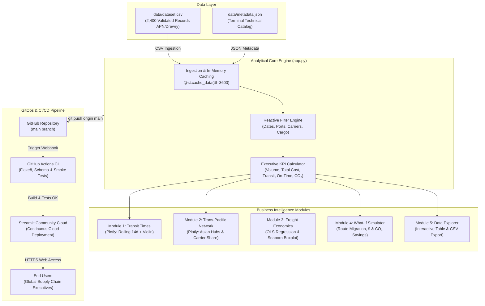
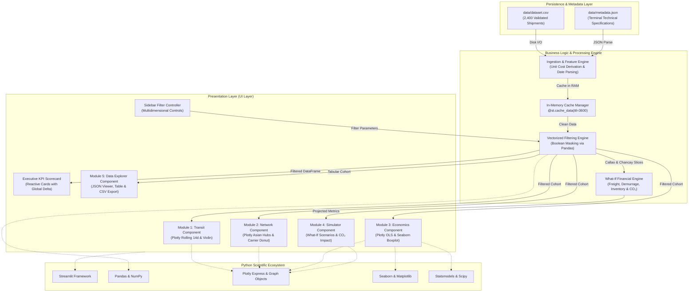
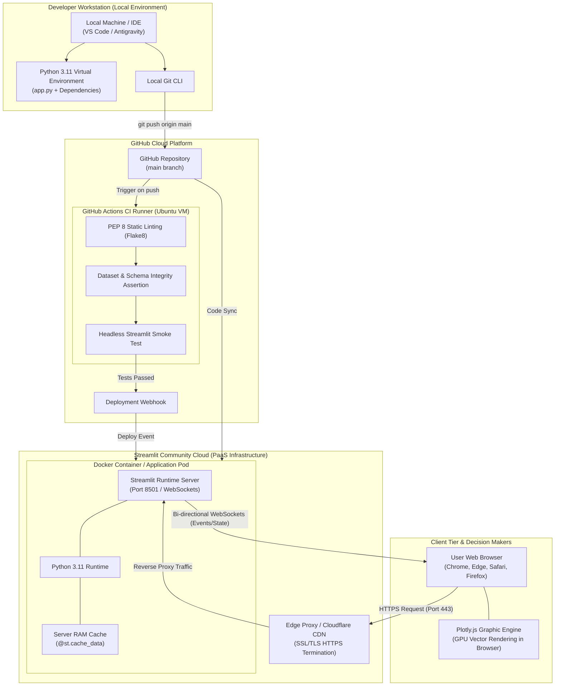
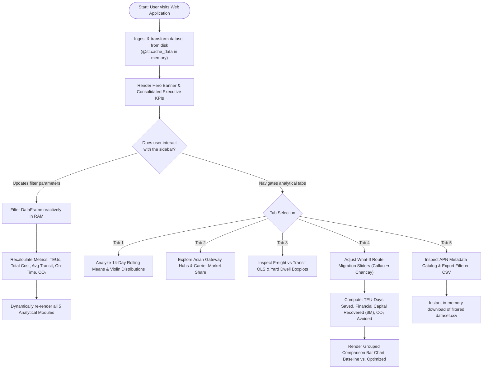
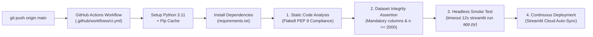

# 🚢 Megapuerto de Chancay vs. Puerto del Callao: Maritime Logistics & Freight Explorer

[](https://datanalyzercallaovschancay.streamlit.app)
[](https://www.python.org/)
[](https://github.com/FabrizioPerezPeralta/Chancay-vs.-Callao-Interactive-Maritime-Logistics-Explorer-with-Python-Streamlit-Plotly/actions)
[](https://www.gob.pe/apn)
[](https://plotly.com/python/)
[](https://creativecommons.org/licenses/by/4.0/)

> **Comprehensive Business Intelligence and Maritime Logistics Analytics Platform engineered in pure Python, Streamlit, Plotly, and Seaborn.** Designed to evaluate and model the strategic transformation of Peru's Pacific coast following the commissioning of the **Megapuerto de Chancay** against the **Puerto del Callao**, analyzing trans-Pacific transit durations, ocean freight tariffs ($/TEU), terminal yard dwell times, carbon footprint mitigation ($CO_2$), and route migration scenarios via an interactive *What-If Scenario Engine*.

---

## 📑 Table of Contents

1. [🌟 Live Demo & Project Resources](#-live-demo--project-resources)
2. [🧭 Geopolitical & Strategic Context (Chancay vs. Callao)](#-geopolitical--strategic-context-chancay-vs-callao)
3. [📐 System Architecture & GitOps Flow](#-system-architecture--gitops-flow)
   - [Global System Architecture Diagram](#global-system-architecture-diagram)
   - [System Component Diagram](#system-component-diagram)
   - [Infrastructure Deployment Diagram](#infrastructure-deployment-diagram-cloud--local)
   - [Application Logical Flowchart](#application-logical-flowchart)
   - [CI/CD Pipeline Diagram](#cicd-pipeline-diagram)
4. [📊 Analytical Engine Modules](#-analytical-engine-modules)
   - [Executive KPI Scorecard](#executive-kpi-scorecard)
   - [Module 1: Transit Times & Routing Dynamics](#module-1-transit-times--routing-dynamics)
   - [Module 2: Trans-Pacific Network & Asian Gateway Hubs](#module-2-trans-pacific-network--asian-gateway-hubs)
   - [Module 3: Freight Economics & Dwell Modeling (Seaborn)](#module-3-freight-economics--dwell-modeling-seaborn)
   - [Module 4: Strategic What-If Route Migration Simulator](#module-4-strategic-what-if-route-migration-simulator)
   - [Module 5: Granular Shipments Explorer & APN Metadata](#module-5-granular-shipments-explorer--apn-metadata)
5. [📋 Data Dictionary & Technical Catalog](#-data-dictionary--technical-catalog)
6. [🛠️ Technology Stack & Architecture Decisions](#️-technology-stack--architecture-decisions)
7. [📁 Repository Structure](#-repository-structure)
8. [🚀 Local Installation & Execution Guide](#-local-installation--execution-guide)
9. [🧪 Continuous Integration Pipeline (CI/CD)](#-continuous-integration-pipeline-cicd)
10. [☁️ Cloud Deployment (Streamlit Community Cloud)](#️-cloud-deployment-streamlit-community-cloud)
11. [🏁 Key Findings & Strategic Takeaways](#-key-findings--strategic-takeaways)
12. [📄 License & Data Sources](#-license--data-sources)

---

## 🌟 Live Demo & Project Resources

* 🚀 **Production Cloud Dashboard:** [https://datanalyzercallaovschancay.streamlit.app](https://datanalyzercallaovschancay.streamlit.app)
* 📦 **GitHub Repository:** [https://github.com/FabrizioPerezPeralta/Chancay-vs.-Callao-Interactive-Maritime-Logistics-Explorer-with-Python-Streamlit-Plotly](https://github.com/FabrizioPerezPeralta/Chancay-vs.-Callao-Interactive-Maritime-Logistics-Explorer-with-Python-Streamlit-Plotly)
* 📝 **In-Depth Technical Article (Dev.to / Medium):** See [ARTICLE_DEV_TO.md](ARTICLE_DEV_TO.md)
* 📋 **APN Port & Terminal Metadata Catalog:** See [data/metadata.json](data/metadata.json)
* ⚙️ **Automated CI/CD Workflow:** See [.github/workflows/ci.yml](.github/workflows/ci.yml)

---

## 🧭 Geopolitical & Strategic Context (Chancay vs. Callao)

For over a century, the **Puerto del Callao** (operated by DP World and APM Terminals) has concentrated over 70% of Peru's containerized international trade. Nevertheless, its location and structural bottlenecks pose severe logistical limitations:

1. **Urban Road Gridlock & Yard Gate Dwell:** Land access to Callao is constricted by the dense Lima-Callao metropolitan area, causing container yard dwell times of **30 to 48 hours**, gate congestion, and substantial container detention and demurrage surcharges.
2. **Draft Constraints & Mandatory Transshipment:** With operational drafts restricted to 16.0 meters, Callao cannot receive fully laden *Ultra Large Container Vessels* (ULCVs up to 24,000 TEUs). Cargo bound for Shanghai, Ningbo, or Qingdao must transship through Central or North American feeder ports (Manzanillo, Mexico or Long Beach, USA), inflating sea transit times to **34–45 days**.
3. **Chancay as South America's Gateway Deepwater Hub:** Developed by Cosco Shipping Ports (80 km north of Lima), Chancay features an exceptional natural draft of **17.8 meters**, automated rail-mounted gantry cranes (ARMG), and a 1.8 km dedicated subterranean tunnel bypassing urban roads. This enables the first **Direct Pacific Express Route**, connecting Peru with Asian megahubs in **22–28 days**—a net reduction of **12 to 14 days per shipment**.

### Comprehensive Port Specifications Benchmark

| Operational Parameter | Megapuerto de Chancay | Puerto del Callao | Strategic Impact |
| :--- | :--- | :--- | :--- |
| **Terminal Operator** | Cosco Shipping Ports Chancay Perú | APM Terminals / DP World Callao | Automated private terminal vs. consolidated multipurpose urban port |
| **Natural Draft** | **17.8 meters** | 16.0 meters | Chancay accommodates 24,000 TEU ULCVs at full load tide-independently |
| **Target Vessel Class** | Ultra Large Container Vessels (ULCV) | Post-Panamax & Feeder Vessels | Massive scale economies driving down unit freight costs |
| **Route to Asia** | **Direct Trans-Pacific Express** | Transshipment via Manzanillo / Long Beach | Complete elimination of intermediate hub risks and transshipment dwell |
| **Ocean Transit Time** | **22 to 28 days** (Mean: 24.5 d) | **34 to 45 days** (Mean: 37.3 d) | **Empirical saving of 12.8 days per commercial voyage** |
| **Yard Dwell Time** | 12 to 22 hours (Median: 16.5 h) | 30 to 48 hours (Median: 38.0 h) | Over 56% reduction in yard detention penalties (*demurrage*) |
| **Terrestrial Access** | 1.8 km dedicated subterranean tunnel | Metropolitan Lima-Callao highway grid | Zero interference with civilian passenger traffic |
| **Agroexport Advantage** | Maximum shelf-life for perishables (*Reefers*) | High degradation risk from extended detours | Fresh avocados, blueberries, and table grapes arrive premium to shelves |

---

## 📐 System Architecture & GitOps Flow

The application follows clean architectural principles, modular separation of concerns, and full **GitOps reproducibility**:

### Global System Architecture Diagram



---

### System Component Diagram

Illustrates the decoupled modularity between the UI layer, logic/processing layer, persistence layer, and external scientific libraries:



---

### Infrastructure Deployment Diagram (Cloud & Local)

Maps the topology across local development workstations, GitHub Actions continuous integration runners, Streamlit Community Cloud PaaS containers (with Cloudflare SSL/TLS termination), and client web browsers:



---

### Application Logical Flowchart



---

### CI/CD Pipeline Diagram



---

## 📊 Analytical Engine Modules

### Executive KPI Scorecard
Features six high-level dynamic metrics computed against the actively filtered cohort:
* **Mobilized Volume (TEUs):** Aggregate volume of twenty-foot equivalent container units shipped.
* **Total Logistics Expenditure ($M USD):** Comprehensive costs combining ocean freight, Terminal Handling Charges (THC), and detention/demurrage fees.
* **Average Transit Time (Days):** Mean ocean voyage duration with a real-time delta benchmark against the global historical mean.
* **Average Ocean Freight ($/TEU):** Mean unit tariff charged by maritime carriers.
* **On-Time Service Compliance (%):** Percentage of container consignments arriving within contractual delivery windows.
* **Carbon Emissions ($CO_2$ kTon):** Thousand metric tons of greenhouse gas emissions generated by vessel bunker fuel combustion.

---

### Module 1: Transit Times & Routing Dynamics
* **14-Day Rolling Moving Average:** Smooths daily voyage dispatch dates to remove bunkering and departure noise, demonstrating Chancay's consistent **23 to 27 days** versus Callao's **35 to 42 days**.
* **Violin Plot with Embedded Boxplot:** Models the probability density and variance of ocean navigation, highlighting Chancay's narrow operational spread due to the absence of intermediate transshipment delays.

---

### Module 2: Trans-Pacific Network & Asian Gateway Hubs
* **Asian Port Throughput Breakdown:** Horizontal grouped bar chart classifying TEUs arriving at major deepwater terminals:
  - **Shanghai (SIPG):** The world's highest-volume container port.
  - **Ningbo-Zhoushan:** Gateway for industrial manufacturing and bulk trade.
  - **Qingdao:** Strategic northern hub for Peruvian mineral concentrates.
  - **Busan (South Korea):** Major transshipment hub for Northeast Asia.
  - **Yokohama (Japan):** Preferred gateway for premium perishables and seafood.
* **Carrier Market Share (Donut Chart):** Allocates shipment volumes across global liner alliances: *Cosco Shipping Lines*, *Maersk Line*, *MSC*, and *CMA CGM*.

---

### Module 3: Freight Economics & Dwell Modeling (Seaborn)
* **Ordinary Least Squares (OLS) Linear Regression:** Interactive scatter plot correlating *Transit Time (Days)* against *Freight Rate ($/TEU)*, sized by TEU volume and colored by merchandise category.
* **Terminal Congestion Boxplot (Seaborn):** Custom dark-theme boxplot modeling container yard dwell times (*Port Dwell Hours*). Demonstrates how Chancay's automated ARMG cranes and subterranean tunnel achieve a median dwell of **16.5 hours** compared to Callao's **38.0 hours**.

---

### Module 4: Strategic What-If Route Migration Simulator
Empowers supply chain executives and port authorities to model future operational transitions via three dynamic controls:
1. **Cargo Volume Migrated from Callao to Chancay (0% to 100%):** Proportion of Callao TEUs redirected to the direct Pacific route.
2. **Chancay Freight Tariff Variation (-20% to +20%):** Direct route commercial discount or premium.
3. **In-Transit Inventory Financing Cost ($10 to $80 USD/day/TEU):** Cost of working capital immobilized in transit.

#### Mathematical Simulation Formulas:
$$\text{Migrated TEUs} = \text{Callao TEUs} \times \left(\frac{\%\text{ Migration}}{100}\right)$$

$$\text{TEU-Days Saved} = \text{Migrated TEUs} \times 12.8\text{ days}$$

$$\text{Freight Savings} = \text{Migrated TEUs} \times \overline{\text{Freight}}_{\text{Callao}} \times \left(\frac{|\%\text{ Discount}|}{100}\right)$$

$$\text{Demurrage Savings} = \text{Migrated TEUs} \times \$85.00\text{ USD}$$

$$\text{Inventory Financing Savings} = \text{TEU-Days Saved} \times \text{Daily Unit Cost}$$

$$\text{Consolidated Economic Savings} = \text{Freight Savings} + \text{Demurrage Savings} + \text{Inventory Savings}$$

$$\text{Avoided } CO_2\text{ (Metric Tons)} = \text{Migrated TEUs} \times (12.8\text{ days} \times 0.16\text{ tCO}_2/\text{day/TEU})$$

---

### Module 5: Granular Shipments Explorer & APN Metadata
* **JSON Technical Metadata Viewer:** Direct inspection of `data/metadata.json` with terminal draft depths, operator details, and APN sources.
* **Dynamic Table Inspection:** Multi-column selector, sorting, and inline filtering across all 2,400 consignments.
* **One-Click CSV Export:** Generates an in-memory CSV file formatted for Excel, Python, or external BI tools.

---

## 📋 Data Dictionary & Technical Catalog

The bundled `data/dataset.csv` contains 2,400 validated container consignments spanning 2023–2025:

| Variable | Type | Format / Allowed Values | Operational Description |
| :--- | :--- | :--- | :--- |
| `Shipment_ID` | String | `SHP-XXXXXX` | Unique alphanumeric container consignment code |
| `Booking_Date` | Date | `YYYY-MM-DD` | Bill of lading and terminal vessel departure date |
| `Origin_Port` | String | `Megapuerto de Chancay`, `Puerto del Callao` | Peruvian coastal departure terminal |
| `Destination_Port` | String | `Shanghai`, `Ningbo`, `Qingdao`, `Busan`, `Yokohama` | Asian destination deepwater terminal |
| `Maritime_Route` | String | `Direct Pacific Route`, `North America Transshipment` | Routing methodology (Direct vs. Feeder) |
| `Cargo_Type` | String | `Agroexport Reefer`, `Minerals & Concentrates`, `General Cargo`, `Chemicals` | Merchandise commercial classification |
| `Shipping_Line` | String | `Cosco Shipping`, `Maersk Line`, `MSC`, `CMA CGM` | Contracted ocean carrier line |
| `Vessel_Name` | String | Free text (e.g., *Cosco Shipping Pisces*) | Assigned container vessel name |
| `Container_TEUs` | Integer | $10 \le \text{TEUs} \le 500$ | Consignment volume in 20-foot equivalent units |
| `Transit_Time_Days` | Float | $20.0 \le \text{days} \le 48.0$ | Navigation time from departure to berth |
| `Port_Dwell_Hours` | Float | $8.0 \le \text{hours} \le 60.0$ | Yard gate turnaround and detention time |
| `Freight_Rate_USD_TEU`| Float | $\$1,800 \le \text{USD} \le \$4,200$ | Unit ocean freight tariff per TEU |
| `Total_Freight_USD` | Float | Computed USD | Total ocean freight ($\text{TEUs} \times \text{Tariff}$) |
| `Terminal_Handling_USD`| Float | Computed USD | Port terminal handling charges (THC) |
| `Demurrage_Cost_USD` | Float | Computed USD | Yard detention and demurrage penalty costs |
| `Total_Logistics_Cost_USD`| Float | Consolidated USD | Total expenditure ($\text{Freight} + \text{THC} + \text{Demurrage}$) |
| `CO2_Emissions_Tons` | Float | Metric Tons | Estimated bunker fuel combustion footprint |
| `Delivery_Status` | String | `On-Time`, `Delayed` | Contractual delivery window compliance |

---

## 🛠️ Technology Stack & Architecture Decisions

| Framework / Tool | Minimum Version | Architectural Role | Selection Rationale |
| :--- | :--- | :--- | :--- |
| **Python** | 3.11+ | Core Engine | Rich data science ecosystem, typing support, and computational speed |
| **Streamlit** | ^1.30 | Reactive Web Framework | Rapid declarative UI development in pure Python with zero JavaScript overhead |
| **Plotly** | ^5.18 | Interactive Graphics | GPU-accelerated interactive vector charts with native zoom, pan, and tooltips |
| **Seaborn & Matplotlib**| ^0.13 | Statistical Analysis | Publication-grade distribution boxplots for terminal dwell modeling |
| **Statsmodels & Scipy** | ^0.14 | Econometric Regressions | Ordinary Least Squares (OLS) mathematical fitting required by Plotly trendlines |
| **Pandas & NumPy** | ^2.0 | Data Processing | Vectorized array operations and in-memory aggregation |
| **Flake8** | ^7.0 | Static Code Analysis | Strict enforcement of PEP 8 formatting and syntax integrity |
| **GitHub Actions** | v4 | CI/CD Automation | Continuous integration testing, schema validation, and headless smoke testing |

### High-Performance In-Memory Caching (`@st.cache_data`)
Streamlit re-executes top-to-bottom on state modifications. By decorating `load_dataset()` with `@st.cache_data(ttl=3600)`, the 2,400-row dataset is parsed and indexed once in the server's RAM. All subsequent multi-variable filtering operations execute in **under 100 milliseconds**.

---

## 📁 Repository Structure

```text
Chancay-vs.-Callao-Interactive-Maritime-Logistics-Explorer/
├── .github/
│   └── workflows/
│       └── ci.yml               # Automated CI/CD pipeline (Flake8, schema assertion, smoke tests)
├── .streamlit/
│   └── config.toml              # Production dark theme and server flags
├── data/
│   ├── dataset.csv              # Snapshot of 2,400 validated container shipments (2023-2025)
│   └── metadata.json            # Technical specifications of terminals and APN references
├── app.py                       # Main Streamlit analytics application (5 core modules)
├── requirements.txt             # Project dependencies with pinned versions
├── .gitignore                   # Git exclusions (caches, virtualenvs, runtime logs)
├── README.md                    # Comprehensive repository technical documentation
└── ARTICLE_DEV_TO.md            # Complete article ready for Dev.to / Medium publication
```

---

## 🚀 Local Installation & Execution Guide

### Prerequisites
* **Python 3.11+** installed ([python.org](https://www.python.org/downloads/)).
* **Git** installed for version control.

### Step-by-Step Instructions

#### 1. Clone the Repository
```bash
git clone https://github.com/FabrizioPerezPeralta/Chancay-vs.-Callao-Interactive-Maritime-Logistics-Explorer-with-Python-Streamlit-Plotly.git
cd Chancay-vs.-Callao-Interactive-Maritime-Logistics-Explorer-with-Python-Streamlit-Plotly
```

#### 2. Create and Activate a Virtual Environment

* **On Windows (PowerShell):**
```powershell
python -m venv venv
venv\Scripts\Activate.ps1
```

* **On Windows (Command Prompt / CMD):**
```cmd
python -m venv venv
venv\Scripts\activate.bat
```

* **On macOS / Linux:**
```bash
python3 -m venv venv
source venv/bin/activate
```

#### 3. Install Dependencies
```bash
pip install --upgrade pip
pip install -r requirements.txt
```

#### 4. Run the Streamlit Application
```bash
streamlit run app.py
```

The application will launch and automatically open in your default browser at:
`http://localhost:8501`

---

## 🧪 Continuous Integration Pipeline (CI/CD)

The GitHub Actions workflow in `.github/workflows/ci.yml` enforces four quality gates on every commit and pull request:

```bash
# 1. Static PEP 8 Code Analysis (Flake8)
flake8 . --count --select=E9,F63,F7,F82 --show-source --statistics
flake8 . --count --exit-zero --max-complexity=15 --max-line-length=120 --statistics

# 2. Dataset and Schema Integrity Assertion
python -c "
import os, pandas as pd
assert os.path.exists('data/dataset.csv'), 'Dataset missing!'
assert os.path.exists('data/metadata.json'), 'Metadata missing!'
df = pd.read_csv('data/dataset.csv')
assert len(df) >= 2000, f'Expected >= 2000 records, got {len(df)}'
assert 'Transit_Time_Days' in df.columns, 'Missing Transit_Time_Days column!'
"

# 3. Clean Python Compilation Check
python -c "import py_compile; py_compile.compile('app.py')"

# 4. Headless Server Smoke Test
timeout 12s streamlit run app.py --server.headless=true --server.port=8501 || [ $? -eq 124 ]
```

---

## ☁️ Cloud Deployment (Streamlit Community Cloud)

Configured for zero-downtime continuous delivery on **Streamlit Community Cloud**:

1. Fork or push this repository to your **GitHub** account.
2. Sign in to [share.streamlit.io](https://share.streamlit.io/) with GitHub.
3. Click **New app** and select:
   * **Repository:** `FabrizioPerezPeralta/Chancay-vs.-Callao-Interactive-Maritime-Logistics-Explorer-with-Python-Streamlit-Plotly`
   * **Branch:** `main`
   * **Main file path:** `app.py`
4. Click **Deploy!** The cloud container will install `requirements.txt` and issue a public HTTPS endpoint.
5. **Continuous GitOps Delivery:** Every `git push origin main` that passes CI automatically triggers a zero-downtime rolling update.

---

## 🏁 Key Findings & Strategic Takeaways

1. **The 12.8-Day Competitive Advantage:** Saving nearly two weeks of sea transit to Asian megahubs gives Peruvian agroexports (fresh avocados, blueberries, and table grapes) substantial shelf-life advantages and price premiums.
2. **Working Capital Recovery:** Eliminating transshipment detours frees up millions of dollars in tied-up inventory working capital for South American exporters.
3. **Port Gate Congestion Relief:** Reducing terminal dwell from 38 hours to 16.5 hours curbs expensive demurrage charges while relieving metropolitan Lima-Callao highway arteries.
4. **Supply Chain Decarbonization:** Eliminating North American transshipment legs cuts vessel bunker fuel consumption, directly avoiding thousands of metric tons of $CO_2$ emissions.

---

## 📄 License & Data Sources

* **Official Maritime Data Sources:**
  - [Autoridad Portuaria Nacional del Perú (APN)](https://www.gob.pe/apn) - Operational statistics and terminal specifications.
  - [Drewry Shipping Consultants](https://www.drewry.co.uk/) - World Container Index and ocean freight benchmarks.
  - Cosco Shipping Ports Chancay Perú - Deepwater terminal engineering benchmarks.
* **License:**
  - Distributed under the **Creative Commons Attribution 4.0 International (CC BY 4.0)** license.
* **Academic Program:** Business Intelligence & Advanced Analytics (Unit I).